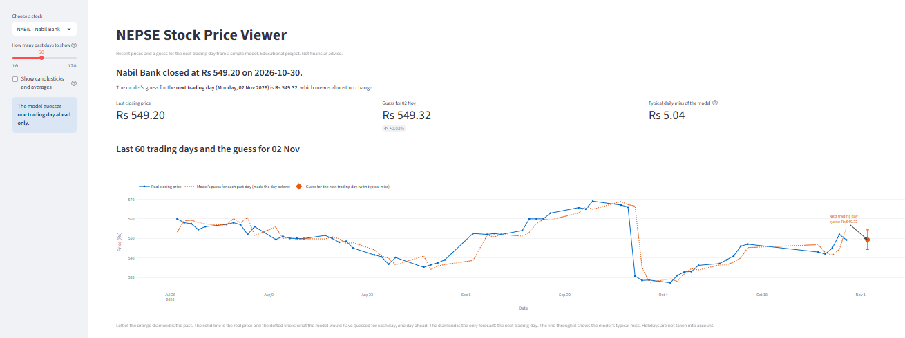
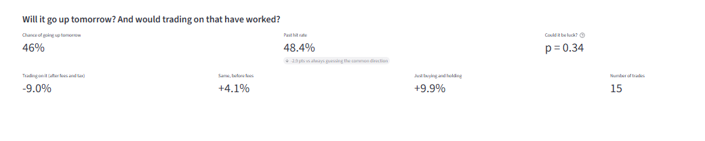
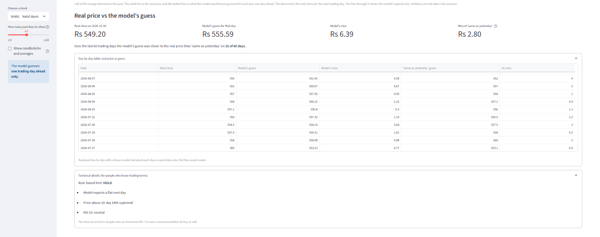
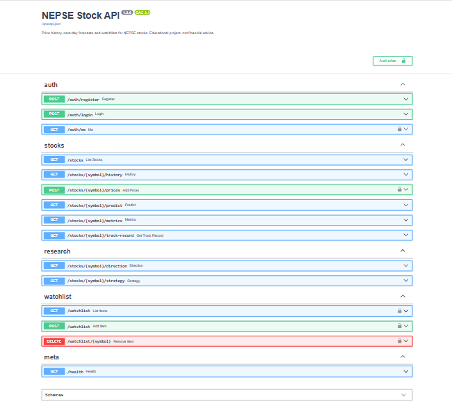
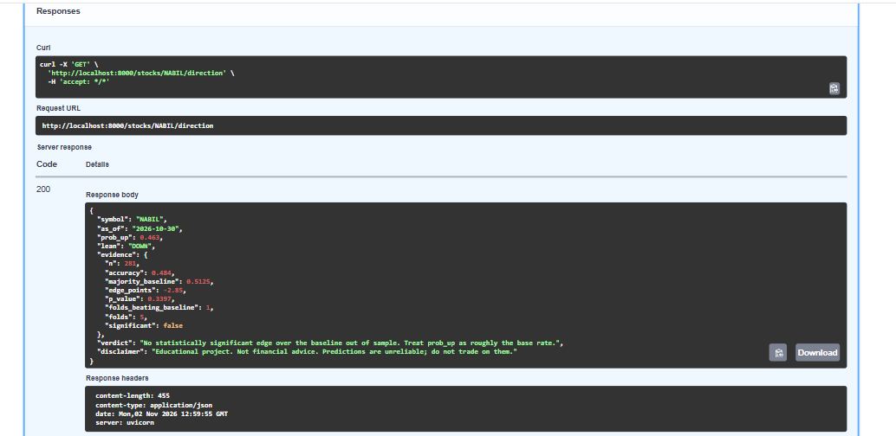
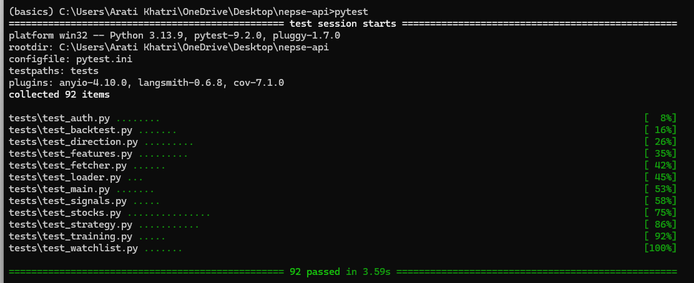

# NEPSE Stock API


REST API for NEPSE price history, next-day close forecasts and per-user
watchlists. Built with FastAPI, SQLAlchemy and scikit-learn. Includes a
Streamlit dashboard that consumes the API.


## Features

- Price history and bulk price upload (validated OHLCV)
- Next day close forecast plus a rule based BUY / SELL / HOLD signal
- JWT auth (register, login) and private watchlists
- Model metrics endpoint with a naive baseline comparison
- Direction model: P(up tomorrow) with a walk forward significance test (`/stocks/{symbol}/direction`)
- Backtester with brokerage, SEBON fee, capital gains tax and holding rules (`/stocks/{symbol}/strategy`)
- Rate limiting on auth routes, scheduled data refresh workflow
- Pytest suite, GitHub Actions CI (tests, lint)
- Request logging, CORS, production config checks

## Screenshots

### Dashboard







### API





## Design notes

- Features at day *t* use data up to day *t*. The target is the close of day
  *t+1*. A test checks that changing the last day never alters earlier features.
- Evaluation uses a time-ordered 80/20 split. Every model is compared with the
  naive baseline "tomorrow = today". Check `/stocks/{symbol}/metrics` for
  `beats_naive`. On price levels, a linear model usually only matches it.
- Routers handle HTTP. `features`, `signals`, `predictor` and `training` are
  plain logic with no web dependency.

## What this project found

No tradable edge on these five stocks.

- Predicting next day price level never beats "tomorrow = today" (0 of 15
  model-stock pairs, see `results/notebook/conclusion.txt`).
- Predicting next day direction is close to a coin flip. Hit rates sit within
  a few points of the always-guess-the-common-direction baseline, and none is
  statistically significant. Adding a market-wide factor raises accuracy by
  about two points on average, which is within the noise.
- A trading rule built on those probabilities loses money after NEPSE costs
  on every stock. It pays fees and tax on small, unreliable edges.

The useful part of the repo is the evaluation setup: leak-free features,
walk-forward folds, baselines, significance tests and a cost model. With
better data (full NEPSE universe, index, sector, news) you can rerun it and
see whether the result changes.

## Results

Walk-forward, 5 expanding folds, out-of-sample only. Flat days are dropped.

### Direction model vs majority-class baseline

| Symbol | Features | n | Accuracy | Baseline | Edge | p-value | Folds won |
|---|---|---|---|---|---|---|---|
| GBIME | stock only | 284 | 52.5% | 52.8% | -0.4 pts | 0.91 | 3/5 |
| GBIME | stock + market | 284 | 53.9% | 52.8% | +1.1 pts | 0.72 | 3/5 |
| NABIL | stock only | 281 | 48.4% | 51.2% | -2.8 pts | 0.34 | 1/5 |
| NABIL | stock + market | 281 | 53.0% | 51.2% | +1.8 pts | 0.55 | 2/5 |
| NICA | stock only | 289 | 55.7% | 57.8% | -2.1 pts | 0.47 | 1/5 |
| NICA | stock + market | 289 | 56.7% | 57.8% | -1.0 pts | 0.72 | 1/5 |
| SCB | stock only | 285 | 51.6% | 49.5% | +2.1 pts | 0.48 | 2/5 |
| SCB | stock + market | 285 | 52.3% | 49.5% | +2.8 pts | 0.34 | 3/5 |
| SHIVM | stock only | 287 | 51.9% | 51.9% | +0.0 pts | 1.00 | 2/5 |
| SHIVM | stock + market | 287 | 53.0% | 51.9% | +1.0 pts | 0.72 | 3/5 |

Significant positive edge (p<0.05): 0 of 10 rows. At that threshold, some
rows would pass by chance alone, so even one or two would not mean much.

### Strategy vs buy-and-hold (net of costs)

Rule fixed in advance: enter when P(up) > 0.55, exit at <= 0.5, hold at least
5 days. Costs are 0.415% per side, plus 7.5% capital gains tax on profit.

| Symbol | Strategy net | Strategy gross | Buy & hold net | Strategy max DD | Trades | In market |
|---|---|---|---|---|---|---|
| GBIME | -19.2% | -7.6% | 7.2% | -24.1% | 15 | 13.4% |
| NABIL | -9.0% | 4.1% | 9.9% | -17.2% | 15 | 12.2% |
| NICA | -9.0% | -2.1% | -7.6% | -15.5% | 8 | 5.0% |
| SCB | -14.3% | 13.2% | 7.8% | -19.3% | 32 | 30.5% |
| SHIVM | -6.3% | 0.4% | 34.1% | -10.4% | 8 | 6.2% |

The strategy beat buy-and-hold after costs on 0 of 5 stocks.

Limits: no slippage, no liquidity limits, trades fill at the close, small
sample, one market regime. Verify current NEPSE fee rates.

Reproduce: `make research` (or `python -m app.research data results`).

## Project layout

```
app/
  main.py            FastAPI app
  config.py          settings from env
  database.py        engine and sessions
  models.py          ORM tables
  schemas.py         request/response models
  security.py        password hashing, JWT
  deps.py            auth dependency, symbol validation
  repository.py      DB rows to DataFrames
  features.py        indicators and training set
  signals.py         BUY / SELL / HOLD rules
  training.py        train + baseline comparison
  direction.py       NEPSE-aware features, walk-forward direction model, significance test
  strategy.py        backtester (fees, SEBON, capital gains tax)
  research.py        runs everything over data/*.csv, writes results/
  ratelimit.py       in-memory limiter for auth routes
  predictor.py       load model, forecast
  fetcher.py         downloads price data to data/*.csv
  loader.py          CSV import CLI
  routers/           auth, stocks, watchlist, research
dashboard/app.py     Streamlit UI (calls the API)
docs/images/         README screenshots
notebooks/           training and model comparison notebook
tests/               pytest suite
```

## Setup

```bash
git clone https://github.com/YOUR-GITHUB-USERNAME/nepse-api
cd nepse-api
python -m venv .venv && source .venv/bin/activate
pip install -r requirements-dev.txt
cp .env.example .env     # then set SECRET_KEY
```

Generate a secret key:

```bash
python -c "import secrets; print(secrets.token_hex(32))"
```

## Get data

Download from the ShareSansarScraper API (with retries and timeouts):

```bash
python -m app.fetcher                # NABIL NICA GBIME SCB SHIVM -> data/*.csv
python -m app.fetcher NABIL HBL      # chosen symbols
```

Or add your own CSVs to `data/`, one per stock, named `<SYMBOL>.csv` with
columns `Date, Open, High, Low, Close, Volume`. Then:

```bash
python -m app.loader data/   # load into the database
python -m app.training       # train one model per symbol into models/
```

Data: [ShareSansarScraper](https://github.com/OmitNomis/ShareSansarScraper)
by OmitNomis (MIT), from ShareSansar.

## Training notebook

`notebooks/nepse_training.ipynb` runs in Google Colab or locally.

- Downloads the data and builds leak-free features (target = next-day return)
- Walk-forward validation with 5 expanding-window folds
- Compares Linear Regression, Random Forest, XGBoost and an LSTM against the naive baseline
- Reports skill score, direction accuracy on days the price moved, and feature importance
- Backtests with brokerage, SEBON fee and capital gains tax against buy-and-hold
- Writes a generated conclusion and CSV results
- Exports `models/<SYMBOL>.joblib` (loaded by the API), LSTM models, scalers and `data/<SYMBOL>.csv`

Copy `models/` and `data/` into this project, then run `python -m app.loader data/`.
The API reads both price-target bundles (`app.training`) and return-target bundles (notebook).

## Run

```bash
uvicorn app.main:app --reload          # API: http://localhost:8000/docs
pip install -r requirements-dashboard.txt
streamlit run dashboard/app.py         # dashboard
```

## Configuration

| Variable | Default | Purpose |
|---|---|---|
| `DATABASE_URL` | `sqlite:///./nepse.db` | SQLAlchemy URL |
| `SECRET_KEY` | `change-me` | JWT signing key (32+ chars in production) |
| `ACCESS_TOKEN_MINUTES` | `60` | Token lifetime |
| `MODEL_DIR` | `models` | Where trained models are stored |
| `ENVIRONMENT` | `development` | `production` enables strict checks |
| `LOG_LEVEL` | `INFO` | Python log level |
| `CORS_ORIGINS` | empty | Comma-separated allowed origins |

## Developer commands

```bash
make install   # dev dependencies
make test      # pytest with coverage
make lint      # ruff
make run       # local API with reload
pre-commit install   # lint on every commit
```

## Endpoints

| Method | Path | Auth | Purpose |
|---|---|---|---|
| GET | `/health` | no | Liveness check |
| POST | `/auth/register` | no | Create account |
| POST | `/auth/login` | no | Get JWT (form fields) |
| GET | `/auth/me` | yes | Current user |
| GET | `/stocks` | no | Symbols, row counts, latest date |
| GET | `/stocks/{symbol}/history?limit=60` | no | Recent OHLCV |
| POST | `/stocks/{symbol}/prices` | yes | Bulk add prices (duplicates skipped) |
| GET | `/stocks/{symbol}/predict` | no | Next-day forecast and signal |
| GET | `/stocks/{symbol}/metrics` | no | Model vs naive baseline |
| GET | `/stocks/{symbol}/track-record` | no | Day-by-day replay vs naive |
| GET | `/stocks/{symbol}/direction` | no | P(up), out-of-sample accuracy, p-value |
| GET | `/stocks/{symbol}/strategy` | no | Net-of-cost backtest vs buy-and-hold |
| GET | `/watchlist` | yes | Your watchlist |
| POST | `/watchlist` | yes | Add symbol |
| DELETE | `/watchlist/{symbol}` | yes | Remove symbol |

Error codes: 401 bad token, 404 unknown symbol, 409 duplicate, 422 invalid
input, 429 too many auth attempts, 503 model not trained.

## Tests

```bash
pytest --cov=app --cov-report=term-missing
ruff check .
```



## Limitations

- About 900 trading days per stock, which is too little for deep models. The
  API serves a linear price model and a logistic direction model. The notebook
  also compares Random Forest, XGBoost and LSTM, and none beats the baseline.
- Fee rates in `app/strategy.py` are small-trade defaults. Verify them.
- The market factor is an equal-weight proxy from five stocks, not the NEPSE index.
- The forecast and BUY / SELL / HOLD signal ignore transaction costs and
  liquidity, and no news data is used.
- Tables are created on startup. Add Alembic migrations before changing the schema in production.

## License

Author: Arati Khatri.